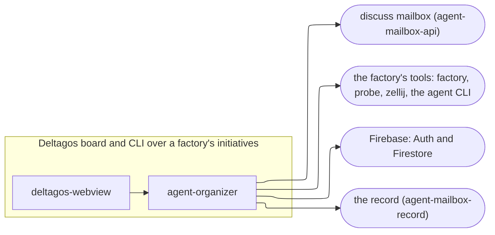

# deltagos: containers (L2)

Generated by `c4-map gen` between the markers; prose outside them is kept.

<!-- c4-map:begin containers -->

| node | level | kind | status | evidence |
|---|---|---|---|---|
| `agent_organizer` | containers | container | exists | repo `agent-organizer@fc56507` |
| `deltagos_webview` | containers | container | exists | repo `agent-organizer/frontend` |
| `discuss_mailbox` | containers | external | exists | external `ext:agent-mailbox-api#fn:mailbox.drain`; external `ext:agent-mailbox-api#fn:mailbox.health`; external `ext:agent-mailbox-api#fn:mailbox.healthz`; external `ext:agent-mailbox-api#fn:mailbox.messages.post`; external `ext:agent-mailbox-api#fn:mailbox.search`; external `ext:agent-mailbox-api#fn:mailbox.thread.get`; external `ext:agent-mailbox-api#fn:mailbox.thread.status.set`; external `ext:agent-mailbox-api#fn:mailbox.threads.list` |
| `factory_tools` | containers | external | exists | curated `context.md` |
| `firebase` | containers | external | exists | curated `context.md` |
| `record` | containers | external | exists | external `ext:agent-mailbox-record#fn:record.factories.cells.post`; external `ext:agent-mailbox-record#fn:record.factories.keys.issue`; external `ext:agent-mailbox-record#fn:record.factories.keys.revoke`; external `ext:agent-mailbox-record#fn:record.usage.post` |

| from | to | evidence |
|---|---|---|
| `agent_organizer` | `discuss_mailbox` | external `ext:agent-mailbox-api#fn:mailbox.health` |
| `agent_organizer` | `factory_tools` | curated `context.md` |
| `agent_organizer` | `firebase` | curated `context.md` |
| `agent_organizer` | `record` | external `ext:agent-mailbox-record#fn:record.usage.post` |
| `deltagos_webview` | `agent_organizer` | repo `agent-organizer/frontend/wailsjs` |
<!-- c4-map:end containers -->
