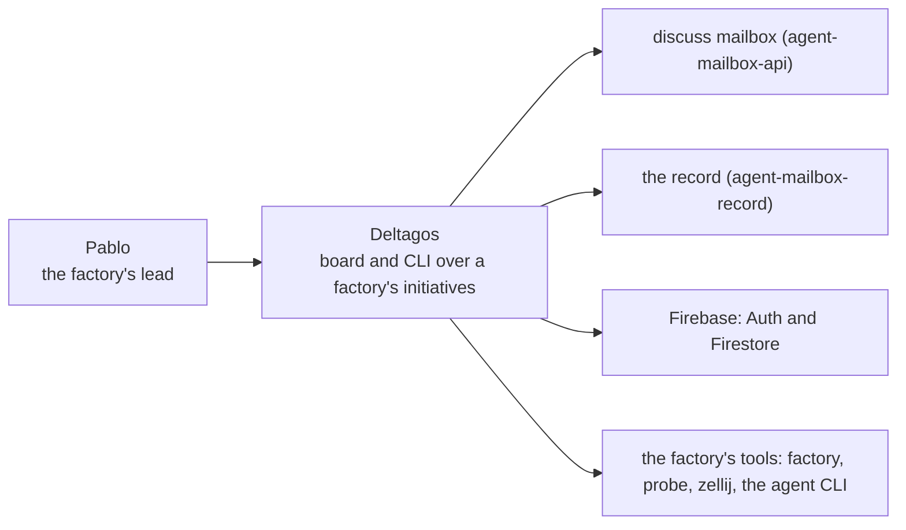

# Deltagos: context (L1)

Deltagos (the organizer: the Wails app and the `organizer` CLI, one binary),
the person who leads the factory with it, and the systems outside it.
Curated by hand from `CLAUDE.md` (Layout) and the `consumes:` lines of
`atlax/elements/`; changed only by a ruled record.

| node | level | kind | status | evidence |
|---|---|---|---|---|
| `pablo` | context | person | exists | curated: `context.md` |
| `deltagos` | context | system | exists | record `0176` |
| `discuss_mailbox` | context | external | exists | curated: `context.md`; external `ext:agent-mailbox-api#fn:mailbox.health` |
| `record` | context | external | exists | curated: `context.md`; external `ext:agent-mailbox-record#fn:record.usage.post` |
| `firebase` | context | external | exists | curated: `context.md` |
| `factory_tools` | context | external | exists | curated: `context.md` |

| from | to | evidence |
|---|---|---|
| `pablo` | `deltagos` | curated: `context.md` |
| `deltagos` | `discuss_mailbox` | external `ext:agent-mailbox-api#fn:mailbox.health` |
| `deltagos` | `record` | external `ext:agent-mailbox-record#fn:record.usage.post` |
| `deltagos` | `firebase` | curated: `context.md` |
| `deltagos` | `factory_tools` | curated: `context.md` |
