# deltagos: modules (L3): agent_organizer

Generated by `c4-map gen` between the markers; prose outside them is kept.

```mermaid
flowchart LR
    %% c4: modules agent_organizer
    subgraph agent_organizer["agent-organizer"]
        agent_organizer__auth["auth"]
        agent_organizer__cache["cache"]
        agent_organizer__cli["cli"]
        agent_organizer__config["config"]
        agent_organizer__diagram["diagram"]
        agent_organizer__discuss["discuss"]
        agent_organizer__keychain["keychain"]
        agent_organizer__lock["lock"]
        agent_organizer__memory["memory"]
        agent_organizer__merge["merge"]
        agent_organizer__model["model"]
        agent_organizer__prompt["prompt"]
        agent_organizer__record["record"]
        agent_organizer__review["review"]
        agent_organizer__scan["scan"]
        agent_organizer__service["service"]
        agent_organizer__session["session"]
        agent_organizer__specpath["specpath"]
        agent_organizer__sync["sync"]
        agent_organizer__usage["usage"]
    end
```

<!-- c4-map:begin modules agent_organizer -->

| node | level | kind | status | evidence |
|---|---|---|---|---|
| `agent_organizer__auth` | modules | module | exists | repo `agent-organizer/internal/auth` |
| `agent_organizer__cache` | modules | module | exists | repo `agent-organizer/internal/cache` |
| `agent_organizer__cli` | modules | module | exists | repo `agent-organizer/internal/cli` |
| `agent_organizer__config` | modules | module | exists | repo `agent-organizer/internal/config` |
| `agent_organizer__diagram` | modules | module | exists | repo `agent-organizer/internal/diagram` |
| `agent_organizer__discuss` | modules | module | exists | repo `agent-organizer/internal/discuss` |
| `agent_organizer__keychain` | modules | module | exists | repo `agent-organizer/internal/keychain` |
| `agent_organizer__lock` | modules | module | exists | repo `agent-organizer/internal/lock` |
| `agent_organizer__memory` | modules | module | exists | repo `agent-organizer/internal/memory` |
| `agent_organizer__merge` | modules | module | exists | repo `agent-organizer/internal/merge` |
| `agent_organizer__model` | modules | module | exists | repo `agent-organizer/internal/model` |
| `agent_organizer__prompt` | modules | module | exists | repo `agent-organizer/internal/prompt` |
| `agent_organizer__record` | modules | module | exists | repo `agent-organizer/internal/record` |
| `agent_organizer__review` | modules | module | exists | repo `agent-organizer/internal/review` |
| `agent_organizer__scan` | modules | module | exists | repo `agent-organizer/internal/scan` |
| `agent_organizer__service` | modules | module | exists | repo `agent-organizer/internal/service` |
| `agent_organizer__session` | modules | module | exists | repo `agent-organizer/internal/session` |
| `agent_organizer__specpath` | modules | module | exists | repo `agent-organizer/internal/specpath` |
| `agent_organizer__sync` | modules | module | exists | repo `agent-organizer/internal/sync` |
| `agent_organizer__usage` | modules | module | exists | repo `agent-organizer/internal/usage` |
<!-- c4-map:end modules agent_organizer -->
