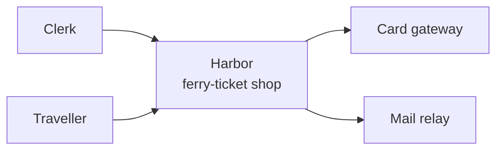

# harbor: context (L1)

The ferry-ticket shop, the people who use it and the systems outside it.
Curated by hand; changed only by a ruled record.

| node | level | kind | status | evidence |
|---|---|---|---|---|
| `clerk` | context | person | exists | curated: `context.md` |
| `traveller` | context | person | exists | curated: `context.md` |
| `harbor` | context | system | exists | record `0001` |
| `card_gateway` | context | external | exists | curated: `context.md` |
| `mail_relay` | context | external | exists | curated: `context.md` |
