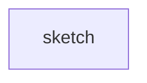
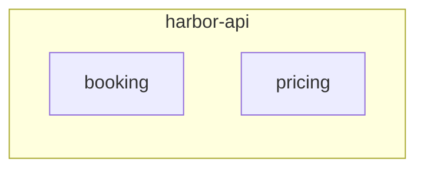
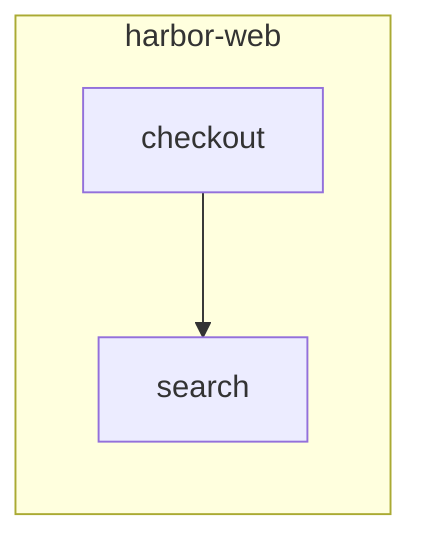

# harbor: modules (L3): harbor_api, web

Generated by `c4-map gen` between the markers; prose outside them is kept.

This block sits outside every region, first on the page, so a reader that
takes the first block draws it for both levels:

<!-- c4-map:begin modules harbor_api -->

| node | level | kind | status | evidence |
|---|---|---|---|---|
| `harbor_api__booking` | modules | module | exists | repo `harbor-api/src/booking` |
| `harbor_api__pricing` | modules | module | exists | repo `harbor-api/src/pricing` |
<!-- c4-map:end modules harbor_api -->

The web app's modules, between their own markers.

<!-- c4-map:begin modules web -->

| node | level | kind | status | evidence |
|---|---|---|---|---|
| `web__checkout` | modules | module | exists | repo `harbor-web/src/checkout` |
| `web__search` | modules | module | exists | repo `harbor-web/src/search` |
<!-- c4-map:end modules web -->
