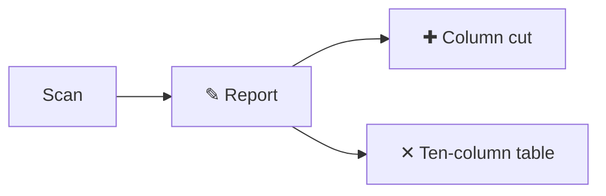

# The scan report, read in the app

status: proposed (fixture)

A fixture spec for the spec reader (docs/specs/diagrams.md FR-6 to FR-8,
D6, D7). The card `w-wide` names it with `spec:
docs/reader.md#the-scan-report`, so its card back's spec link lands on
that section. It is taller than the drawer at 1024×640.

## Problem and appetite

The nightly scan's report runs wider than any window, so whoever reads it
in the morning scrolls sideways before the Monday call and still cannot
say which column is late. Appetite: one card.

The report is read by the lead on the board, by acme's lead from a
printed copy, and by an agent's review prompt; each reads a different
cut of the same ten columns. None of them reads all ten.

## Goals

- The report fits a window at 1024 px without scrolling sideways.
- The lead says from the report alone which three cards are late.
- An agent's review prompt carries the same cut, not the whole table.

## Non-goals

- A mobile layout, an email digest, or a chart.
- Writing to acme's card files.

## Requirements

- **FR-1** The report shows id, stage, now, blocked and waiting by
  default, and the other five columns only when asked.
- **FR-2** A column asked for that does not exist is named in one line
  and the report still prints.
- **FR-3** The report's width is measured once per run, not per row.

## Change on the map

## Rabbit holes

- Measuring the terminal: the report never asks the terminal its width;
  the cut is a flag, not a guess.
- Wrapping cells: a wrapped cell reads as two rows on a printed copy.

## The scan report

Which columns stay is ruled in
[0012, draw the change on the map](../working-on/decisions/0012-draw-the-change-on-the-map.md);
the first spec of this initiative is [the shape](../specs/01-shape.md).
A link to a record that does not exist reads missing:
[0099, never written](../working-on/decisions/0099-never-written.md).

| column | default | why |
|---|---|---|
| id | yes | the row's name |
| stage | yes | where it stands |
| now | yes | what moves |
| blocked | yes | what waits on someone |
| waiting | yes | decisions on the lead |

## Acceptance

| # | FR | Check | Expected |
|---|---|---|---|
| R1 | 1 | the report at 1024 px | five columns, no sideways scroll |
| R2 | 2 | `--columns nope` | one line naming `nope`, the report prints |
| R3 | 3 | a run over 40 initiatives | one width measurement |
