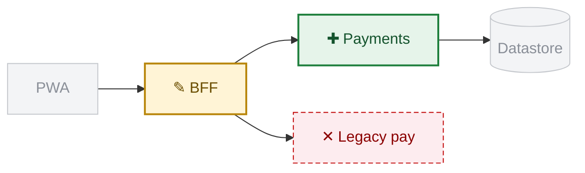

## Question

Does a record show its change as a figure on the base map, or in prose?

## Change on the map

## The nightly scan, end to end

```mermaid
flowchart LR
    cron["Nightly timer"] --> scan["Scan the roots"] --> cards["Read the cards"] --> records["Read the records"]
    records --> roadmap["Read the roadmap"] --> merge["✎ Merge the board"] --> cache["Write the cache"]
    cache --> sync["Push the snapshot"] --> pull["Pull every machine"] --> board["Draw the board"]
    class cron,scan,cards,records,roadmap,cache,sync,pull,board context
    class merge changed
```

## Options

- **figure**: the change drawn on the base map, with a text line under it.
- **prose**: the change described in words only.

## Ruling

figure. pablo, 2026-10-15, in the organizer on fixture.
